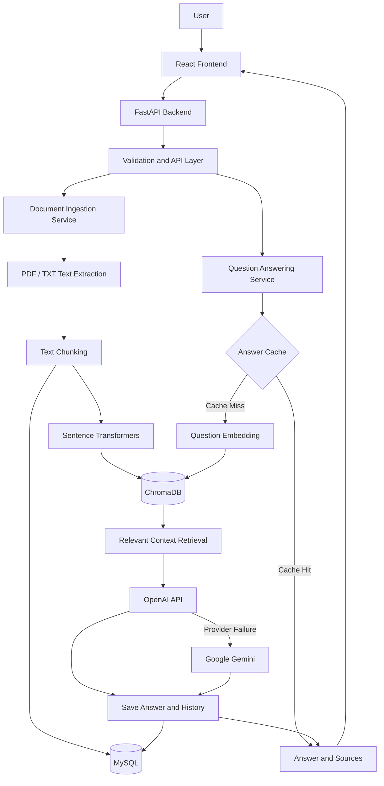
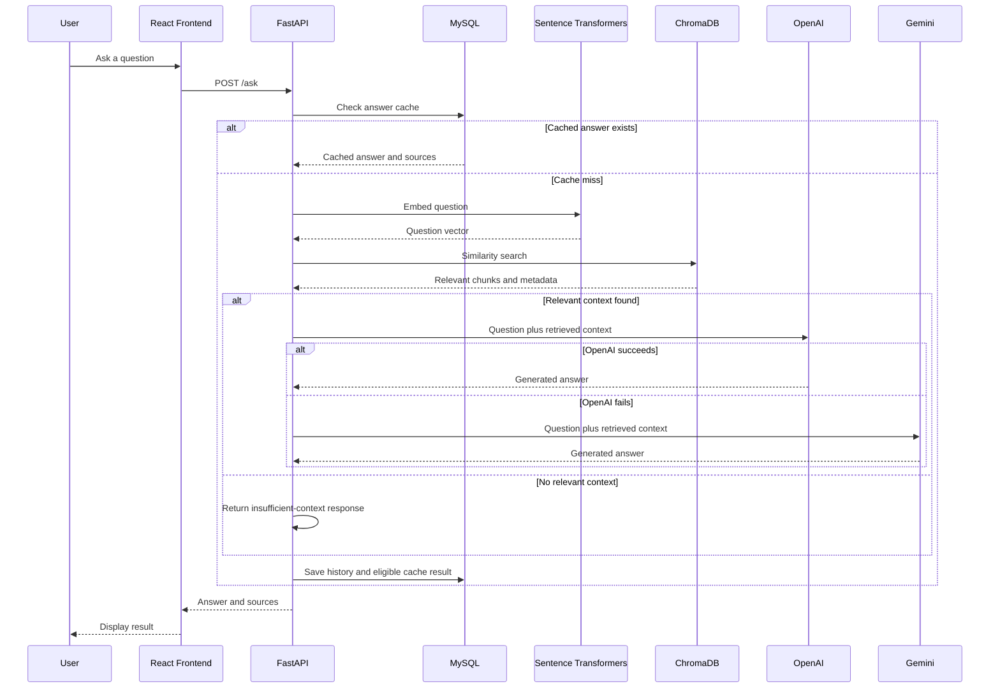
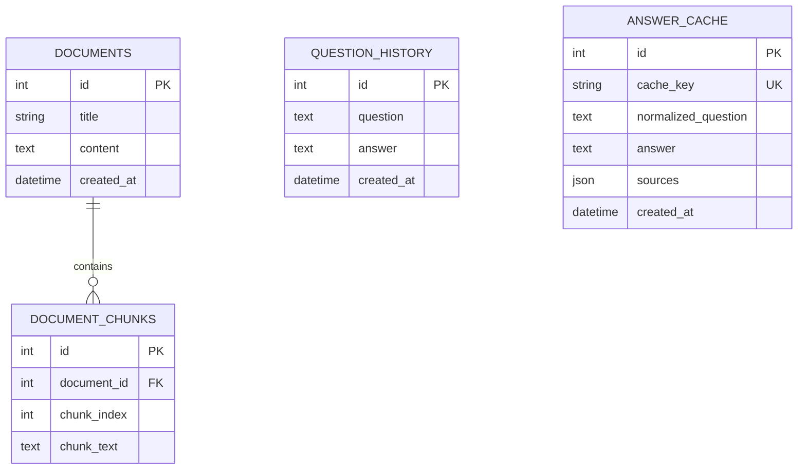

# Knowledge Assistance — Architecture Document

## 1. Overview

Knowledge Assistance is a document-based question-answering application built using Retrieval-Augmented Generation (RAG). Users upload PDF or TXT files and ask questions about their content. The application retrieves relevant text chunks from a vector database and uses a Large Language Model (LLM) to generate answers grounded in the retrieved context.

The system combines relational storage, semantic search, embedding generation, LLM integration, caching, request validation, and rate limiting.

### Technology Stack

| Component | Technology | Responsibility |
|---|---|---|
| Frontend | React, Vite | Document upload, document listing, questions, and answers |
| Backend | Python, FastAPI | API endpoints, validation, and application orchestration |
| Relational database | MySQL | Documents, chunks, question history, and answer cache |
| Vector database | ChromaDB | Embedding storage and semantic similarity search |
| Embedding model | Sentence Transformers, `all-MiniLM-L6-v2` | Convert text into numerical vector representations |
| Primary LLM | OpenAI API, `gpt-4o-mini` | Generate answers using retrieved context |
| Fallback LLM | Google Gemini, `gemini-2.5-flash` | Generate answers when the primary provider fails |
| ORM | SQLAlchemy | Database access and relational data management |
| Rate limiting | In-memory token bucket | Restrict excessive requests to the question-answering endpoint |
| Logging | Python logging | Application diagnostics and transaction tracking |

## 2. High-Level Architecture



The in-memory token bucket rate limiter is applied to the `/ask` endpoint. Request validation, error handling, logging, and transaction tracking support the API layer.

## 3. Document Ingestion Flow

Document ingestion prepares uploaded files for retrieval.

1. **Upload:** The React frontend sends a PDF or TXT file to `POST /documents/upload`.
2. **Validation:** FastAPI checks the file extension, file size, and whether the content can be read.
3. **Text extraction:** The backend extracts text from the uploaded document.
4. **Chunking:** The extracted text is divided into smaller, overlapping chunks.
5. **Embedding generation:** Sentence Transformers converts each chunk into a vector.
6. **Relational storage:** MySQL stores the document and its associated text chunks.
7. **Vector storage:** ChromaDB stores the embeddings, chunk identifiers, and metadata used for retrieval.
8. **Response:** The API returns the created document details to the frontend.

### Chunking Strategy

The current implementation uses character-based chunking with the following default configuration:

| Parameter | Value |
|---|---:|
| Chunk size | 500 characters |
| Chunk overlap | 100 characters |
| Embedding model | `all-MiniLM-L6-v2` |

Chunk overlap preserves some context between adjacent chunks. This helps when a relevant passage spans a chunk boundary.

The current character-based approach is simple to implement. A future version could use token-aware chunking and document-specific strategies for headings, paragraphs, and tables.

### Embedding Generation

The Sentence Transformers model converts each text chunk into a numerical vector. At question time, the same embedding model converts the user's question into a vector in the same embedding space.

Using the same model for both documents and queries is important because their vectors must be comparable.

### Storage Responsibilities

MySQL and ChromaDB serve different purposes:

- **MySQL:** Stores structured application data, document content, chunk records, question history, and cached answers.
- **ChromaDB:** Stores vectors and associated metadata to support semantic similarity search.

The vector database is not a replacement for the relational database. MySQL remains the source of truth for the application's relational records.

## 4. Retrieval-Augmented Generation (RAG) Flow

RAG combines information retrieval with LLM-based answer generation.

### Step 1: Receive the Question

The frontend submits a question to `POST /ask`.

Example:

```json
{
  "question": "What is the refund policy?"
}
```

FastAPI validates the request before passing it to the question-answering service.

### Step 2: Check the Answer Cache

The backend normalizes the question and generates a cache key. If a matching cached answer exists, the backend can return the saved answer and source references without repeating embedding generation, vector retrieval, and the LLM call.

Caching reduces latency and repeated LLM costs.

Cache invalidation must be considered when documents are added, modified, or deleted. A cached answer can become stale when its supporting documents change.

### Step 3: Generate the Question Embedding

If there is no cache hit, Sentence Transformers converts the question into an embedding vector.

### Step 4: Retrieve Relevant Chunks

ChromaDB searches the stored vectors for chunks semantically similar to the question. The application retrieves the highest-ranked candidates and applies a relevance threshold.

The current retrieval configuration uses a top-k value of three, subject to the number of available chunks.

The relevance threshold must be tuned against actual documents and questions. Too strict a threshold can exclude useful passages; too loose a threshold can introduce unrelated context.

### Step 5: Construct the Context

The backend collects the retrieved chunk text and associated metadata, including document identifiers and titles.

Only relevant context should be sent to the LLM, rather than the entire collection of uploaded documents.

If no sufficiently relevant chunks are found, the application should return a clear response indicating that the available documents do not contain enough information.

### Step 6: Generate the Answer

The backend sends the question and retrieved context to OpenAI.

The LLM should be instructed to answer from the supplied context and avoid inventing unsupported facts. If the primary provider fails, the backend attempts to use Google Gemini as a fallback.

Provider timeouts and failures should be logged without exposing credentials or sensitive document content.

### Step 7: Return the Answer and Sources

The backend returns the generated answer and relevant source references to React.

The answer and question history are saved in MySQL, and the result may be cached for subsequent identical questions.

### RAG Sequence Diagram



## 5. Database Design

The application uses MySQL for structured records.

### 5.1 Documents

Stores the original text and metadata for each uploaded document.

| Column | Purpose |
|---|---|
| `id` | Primary key |
| `title` | Document title |
| `content` | Extracted document text |
| `created_at` | Creation timestamp |

### 5.2 DocumentChunks

Stores the individual text chunks associated with a document.

| Column | Purpose |
|---|---|
| `id` | Primary key |
| `document_id` | Foreign key referencing `documents.id` |
| `chunk_index` | Position of the chunk within the document |
| `chunk_text` | Text content of the chunk |

Relationship: one document can have many chunks.

The chunk identifier is also associated with the corresponding ChromaDB vector record through metadata.

### 5.3 QuestionHistory

Stores questions submitted by users and the corresponding answers.

| Column | Purpose |
|---|---|
| `id` | Primary key |
| `question` | Submitted question |
| `answer` | Generated answer |
| `created_at` | Creation timestamp |

This table can support usage analysis and troubleshooting. A future multi-user implementation should associate history with authenticated users where appropriate.

### 5.4 AnswerCache

Stores reusable answers for normalized questions.

| Column | Purpose |
|---|---|
| `id` | Primary key |
| `cache_key` | Unique SHA-256 hash of the normalized question |
| `normalized_question` | Normalized question text |
| `answer` | Cached answer |
| `sources` | Serialized source references |
| `created_at` | Cache creation timestamp |

The unique cache key allows the application to identify matching questions. For production use, cache entries should include document-version or collection-version information, or use another invalidation strategy to prevent stale answers.

### Entity Relationship Diagram



Question history and answer cache are separate records; the current design does not require a foreign-key relationship between them.

## 6. API Design

| Method | Endpoint | Responsibility |
|---|---|---|
| `GET` | `/health` | Check backend health |
| `POST` | `/documents` | Create a document using JSON |
| `GET` | `/documents` | List available documents |
| `POST` | `/documents/upload` | Upload a PDF or TXT document |
| `POST` | `/ask` | Ask a question and retrieve an answer |

### Request Processing

The API layer validates inputs and delegates business logic to service modules. Separating API handlers from services helps keep routing, retrieval, ingestion, and LLM integration independently maintainable.

The current frontend communicates with FastAPI over HTTP. CORS is configured to allow the local React development server.

## 7. Rate Limiting

The application uses an in-memory token bucket rate limiter for `POST /ask`.

### Configuration

| Parameter | Current configuration |
|---|---|
| Token capacity | 20 tokens |
| Refill rate | Approximately 20 tokens per minute |
| Scope | Client IP address |
| Storage | Application memory |
| Exceeded limit | HTTP 429 |
| Retry information | `Retry-After` header |

### Token Bucket Behavior

1. Each client starts with a bucket containing up to the configured capacity.
2. Tokens are replenished according to elapsed time and the configured refill rate.
3. A request consumes a token when permitted.
4. If insufficient tokens are available, the request is rejected with HTTP 429.
5. The client receives a retry hint through the `Retry-After` header.

### Current Limitations

The current implementation is suitable for a local demonstration, but it has important limitations:

- State is not shared between workers or application instances.
- A restart resets the in-memory buckets.
- Per-IP limits may affect users who share a public IP address.
- An in-memory dictionary requires cleanup of inactive client entries.
- Concurrent access needs careful synchronization when requests are handled simultaneously.

For distributed deployment, Redis-backed token buckets or another shared rate-limiting service would provide consistent limits across instances.

## 8. Error Handling and Observability

The application includes request validation, exception handling, transaction tracking, and application logging.

Important operational practices include:

- Reject unsupported file types and oversized uploads.
- Handle empty or unreadable document content.
- Apply timeouts to external LLM calls.
- Handle primary and fallback provider failures.
- Return appropriate HTTP status codes.
- Log request failures with transaction identifiers.
- Avoid logging API keys, secrets, and sensitive document content.
- Monitor database, embedding, vector-search, and LLM latency separately.

A transaction ID helps correlate events across the request lifecycle. In a larger deployment, centralized structured logging and distributed tracing would make troubleshooting easier.

## 9. Scaling Strategy

Scaling depends not only on the number of documents, but also on average document length, chunk count, embedding dimensions, query concurrency, latency requirements, and the size of the LLM context.

The following stages are proposed architectural directions, not performance benchmarks for the current implementation.

### Stage 1: Approximately 10K Documents

**Goal:** Support a small deployment with straightforward operations.

Recommended approach:

- Keep FastAPI as a modular application.
- Use MySQL with indexes on primary keys and foreign keys.
- Keep ChromaDB persistent on reliable local storage.
- Reuse the embedding model rather than loading it for every request.
- Retain answer caching for repeated questions.
- Tune chunk size, overlap, top-k, and the relevance threshold.
- Add pagination to document listing as the collection grows.
- Monitor ingestion failures, retrieval quality, and LLM latency.

At this stage, a single application instance may be sufficient if measured load and available resources support it.

### Stage 2: Approximately 100K Documents

**Goal:** Improve throughput, resilience, and operational maintainability.

Recommended changes:

- Introduce background document ingestion so large uploads do not block request handling.
- Use a task queue and workers for extraction, chunking, and embedding generation.
- Move uploaded files to durable object storage.
- Evaluate ChromaDB deployment options and persistence requirements under concurrent load.
- Add database indexes based on actual query patterns.
- Use pagination and connection-pool tuning.
- Move rate-limiter state to Redis for consistent limits across API instances.
- Add monitoring for embedding throughput, vector-search latency, cache hit rate, and provider errors.
- Introduce cache invalidation tied to document updates.

A background ingestion workflow also makes retries possible when embedding generation or vector insertion fails.

### Stage 3: Approximately 1M Documents

**Goal:** Support a large collection with stronger availability and predictable performance.

Recommended changes:

- Deploy multiple stateless FastAPI instances behind a load balancer.
- Use shared Redis for rate limiting and, where appropriate, distributed caching.
- Use a vector database deployment designed and benchmarked for the required scale and concurrency.
- Evaluate managed or distributed vector-search alternatives if the current ChromaDB setup cannot meet the service-level objectives.
- Separate ingestion workers from interactive question-answering workloads.
- Store original files in object storage rather than relying on application-local disk.
- Partition or archive large relational tables where justified by measured workload.
- Add database read replicas if read traffic and consistency requirements support them.
- Use batch embedding and controlled concurrency to manage compute costs.
- Add retrieval filtering, reranking, and evaluation to maintain answer quality.
- Apply authentication, authorization, tenant isolation, backups, disaster recovery, and observability.

At this scale, capacity should be established through representative load tests rather than document count alone.

### Scaling Summary

| Area | 10K documents | 100K documents | 1M documents |
|---|---|---|---|
| API | Modular FastAPI application | Multiple instances if needed | Load-balanced stateless instances |
| Ingestion | Synchronous where practical | Background workers | Scalable worker pool and batch processing |
| Relational storage | Indexed MySQL | Index and pool tuning | Evaluate partitioning, replicas, and archival |
| Vector storage | Persistent ChromaDB | Benchmark concurrent workload | Distributed or managed vector infrastructure if required |
| Rate limiting | In-memory token bucket | Shared Redis recommended | Distributed shared rate limiting |
| File storage | Local storage for development | Durable object storage | Object storage with lifecycle policies |
| Caching | MySQL answer cache | Version-aware invalidation | Distributed cache where useful |
| Monitoring | Application logs | Metrics and alerting | Centralized observability and tracing |

## 10. Reliability and Data Consistency

Document ingestion writes data to both MySQL and ChromaDB. These systems do not participate in one shared database transaction, so partial failures are possible.

For example, a vector insert may succeed while the MySQL transaction later fails, or a MySQL transaction may succeed while vector insertion fails.

For a more reliable implementation:

1. Assign stable identifiers to document chunks.
2. Track ingestion status in MySQL.
3. Make vector upserts idempotent.
4. Retry failed operations safely.
5. Remove orphaned vector records during recovery.
6. Use a background job or outbox-style workflow when durable processing is required.
7. Ensure document updates and deletions also update associated vectors and invalidate affected cache entries.

The current implementation should be treated as a demonstration of the workflow; robust cross-store recovery is a production improvement.

## 11. Security Considerations

Before production deployment, the application should add or verify:

- Authentication and authorization.
- Per-user document access controls.
- Upload content and file-size validation.
- Secure secret management.
- Request timeouts and resource limits.
- Safe file handling and cleanup of failed uploads.
- Protection against prompt injection contained in uploaded documents.
- Separation of trusted instructions from retrieved document content.
- Controls preventing one user's sources from appearing in another user's answers.
- Database and vector-store backups.
- HTTPS and appropriate deployment configuration.

Retrieved document content must be treated as untrusted data, not as instructions that can override the application's intended behavior.

## 12. Design Decisions

### Why FastAPI?

FastAPI provides a clear API structure, request validation, automatic OpenAPI documentation, and a convenient foundation for Python-based AI integrations.

### Why React?

React provides a component-based frontend for document upload, listing, question submission, and answer display.

### Why MySQL?

MySQL stores structured entities and relationships, including document records, chunks, history, and cached answers.

### Why ChromaDB?

ChromaDB provides vector storage and similarity search for semantic retrieval without requiring the application to implement vector indexing from scratch.

### Why Sentence Transformers?

The embedding model runs locally and creates vectors without requiring a paid embedding API call for every chunk or question.

### Why OpenAI with Gemini Fallback?

OpenAI is the primary answer-generation provider. Gemini provides an alternate provider path when the primary service fails, improving resilience when fallback configuration and error handling are functioning correctly.

### Why RAG Instead of Sending Entire Documents to the LLM?

RAG retrieves a smaller set of relevant passages, reducing unnecessary context, helping ground answers in uploaded content, and supporting source references.

### Why a Token Bucket?

A token bucket permits short bursts up to its capacity while controlling the average request rate. The current in-memory implementation is simple for a demonstration; a shared store is required for consistent distributed enforcement.

## 13. Future Enhancements

- Redis-backed distributed rate limiting.
- Asynchronous document ingestion and retry workflows.
- Hybrid keyword and vector retrieval.
- Reranking of retrieved chunks.
- Retrieval-quality evaluation using representative question sets.
- Version-aware cache invalidation.
- Document update and deletion workflows.
- User authentication and tenant isolation.
- Docker-based deployment and automated delivery pipelines.
- Centralized monitoring and tracing.
- Load testing and capacity planning.

## 14. Conclusion

Knowledge Assistance demonstrates a complete document question-answering workflow using FastAPI, React, MySQL, ChromaDB, Sentence Transformers, and LLM integration.

The architecture separates ingestion, relational storage, semantic retrieval, answer generation, and API handling. The current implementation provides a foundation for local usage and demonstration, while the scaling roadmap describes the additional infrastructure and reliability work needed for larger document collections and production traffic.
